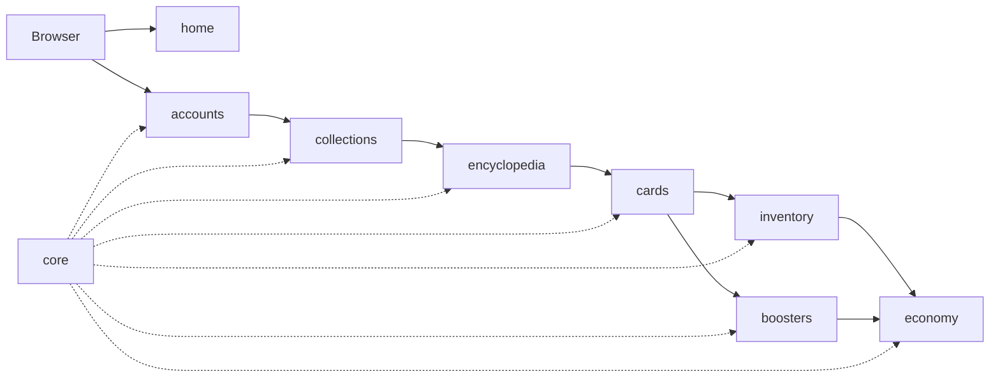
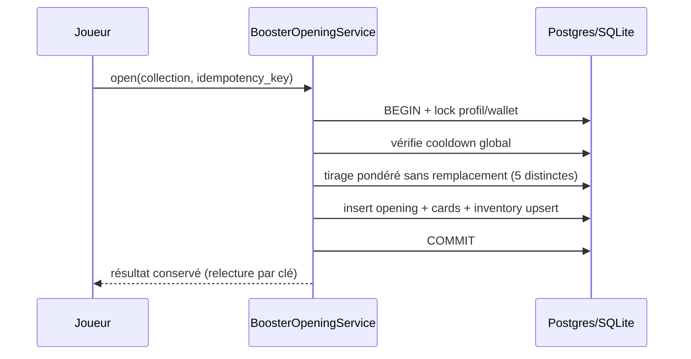

# Architecture WikiCards

## 1. État actuel audité

- `app/settings.py` : Django 5.2.18, `home` installé, `APP_DIRS=True`, SQLite, `EMAIL_BACKEND` console.
- `app/urls.py` : `admin/` + `include('home.urls')`.
- `home/` : `HomeView(TemplateView)`, `home/index.html` extends `base.html`, 4 tests OK.
- `requirements.txt` : `Django==5.2.18`.
- Manques : 8 apps métier, pytest, Ruff, Tailwind, CI, Postgres prod, variables d'env.

`home` est conservée comme **page d'accueil publique** (décision validée). `core` contiendra la config partagée (base templates, utilitaires), pas la landing.

## 2. Découpage Django

- `core` : settings helpers, mixins, templates de base partagés, constantes gameplay (cooldown 600s, prix 250).
- `accounts` : `User` custom UUID + `PlayerProfile` + `Wallet` ? Non : `Wallet` vit dans `economy` (évite cycle). `accounts` expose `get_player(user)`.
- `collections` : `Collection`, catégories.
- `encyclopedia` : `EncyclopediaEntity`, `ImportJob`, clients Wikimedia (aucun appel pendant ouverture).
- `cards` : `Rarity`, `Card`, `RarityAssignmentService`.
- `inventory` : `InventoryEntry` (unique joueur+carte).
- `boosters` : `BoosterOpening`, `BoosterOpeningCard`, `BoosterOpeningService`, `BoosterPurchase` ? Non : achat dans `economy` (`BoosterPurchaseService`) qui appelle `boosters` (dépendance explicite à sens unique : economy → boosters → cards/inventory).
- `economy` : `Wallet`, `WalletTransaction`, `CardSaleService`.

Règle : vues fines, logique dans `services.py` testables, `select_for_update` + `transaction.atomic`, contraintes DB, idempotence par clé.

## 3. Flux critiques

Achat : `economy` débite wallet + crée `BoosterPurchase`, puis délègue tirage à `boosters`, même transaction. Vente : `inventory` décrémente (min 1) + `economy` crédite + transaction loggée.

## 4. Front

Templates Django + HTMX pour fragments (album, filtres, boutique), JS vanilla uniquement animations/révélation, Tailwind compilé local (`static/`), nav basse mobile, effets par rareté, `prefers-reduced-motion`.

## 5. Données / infra

SQLite dev, PostgreSQL prod via `DATABASE_URL` + variables d'env (jamais en Git). `ImportJob` traçable, reprise sur interruption. Limite MVP : **100 requêtes max** par import initial (`--limit 100`).
