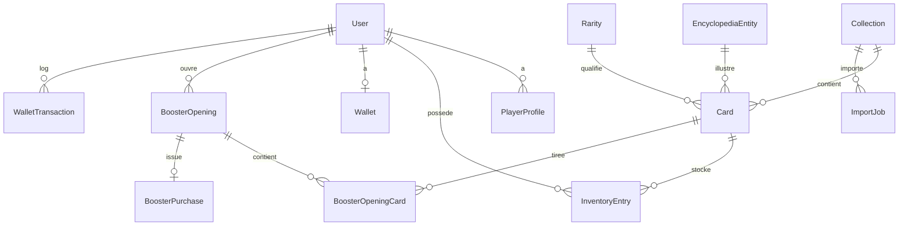

# Base de données WikiCards

## 1. Principes

- PK UUID pour `User`, ID auto pour autres tables sauf contrainte métier.
- `UniqueConstraint` : `Card(collection, entity)`, `InventoryEntry(player, card)`, `WalletTransaction(reference)` unique, `BoosterOpening(idempotency_key)` unique.
- Index : `Card(collection, rarity, is_active)`, `InventoryEntry(player, card)`, `BoosterOpening(player, -created_at)`, `WalletTransaction(player, -created_at)`, `EncyclopediaEntity(wikidata_id)` unique.
- Suppressions : `CASCADE` profil/inventaire/wallet à la suppression user (avec archivage logique si RGPD), `PROTECT` sur `Rarity` et `Collection` référencées, `SET_NULL` image/attribution si besoin.
- Tout débit/crédit : `transaction.atomic()` + `F()` + `select_for_update()` (Postgres) ; SQLite : même code, documenter limite concurrence (un writer).

## 2. Modèles (résumé, détails en code)

**User** : `id UUID PK`, `username` unique, `email` unique, password hashé, `date_joined`, `is_active`, `is_staff`. Custom `AUTH_USER_MODEL = 'accounts.User'`.

**PlayerProfile** : `user OneToOne`, `last_free_opened_at`, `next_free_available_at` (propriété), stats dénormalisées (`total_opened`, `unique_discovered`), préférences JSON.

**Collection** : `slug` unique, `name`, `description`, `image`, `status` (draft/active/archived), `display_order`, `import_config JSON`, `gameplay_params JSON` (cooldown_s=600, booster_price=250, size=5).

**EncyclopediaEntity** : `wikidata_id` unique (ex `Q42`), `label`, `label_fr`, `description_fr`, `wikipedia_url_fr`, `props JSON` (naissance, nationalité, poste, club + `fetched_at`), `image_url`, `image_attribution`, `license`, `pageviews_60d` nullable, `synced_at`.

**Rarity** : `code` unique (common/uncommon/rare/epic/legendary), `name`, `color`, `draw_weight` (55/25/12/6/2), `sale_value` (5/15/50/150/500), `order`, `is_active`.

**Card** : `collection FK`, `entity FK`, `rarity FK` (finale), `auto_score` nullable, `auto_rarity FK` nullable, `is_manual_override` bool, `is_locked` bool, `is_active` bool, `sale_value_override` nullable, `game_meta JSON`. `Unique(collection, entity)`.

**InventoryEntry** : `player FK`, `card FK`, `quantity`, `first_seen_at`, `last_obtained_at`. `Unique(player, card)`. Vente dernier exemplaire interdite (vérif `quantity > 1`).

**BoosterOpening** : `player`, `collection`, `kind` (free/paid), `created_at`, `idempotency_key` unique (UUID client), `status`, `result_cache JSON`.

**BoosterOpeningCard** : `opening FK`, `card FK`, `position` 1..5. `Unique(opening, card)` + `Unique(opening, position)`.

**Wallet** : `player OneToOne`, `balance` int >= 0 (`CheckConstraint`).

**WalletTransaction** : `player`, `type` (sale/purchase/reward/adjust), `amount` signé, `balance_after`, `reference` unique, `created_at`. Solde recalculable par audit.

**BoosterPurchase** : `player`, `collection`, `price` (250 défaut), `created_at`, `opening OneToOne` nullable.

**ImportJob** : `collection`, `params JSON` (limit=100), `status`, `progress`, `errors JSON`, `started_at`, `finished_at`.

## 3. Migrations

Ordre : `accounts` → `collections` → `encyclopedia` → `cards` → `inventory` → `boosters` → `economy`. Chaque `CheckConstraint`/`UniqueConstraint` testée.
